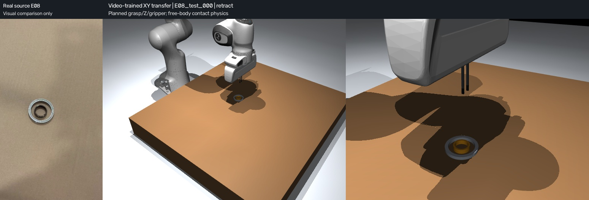
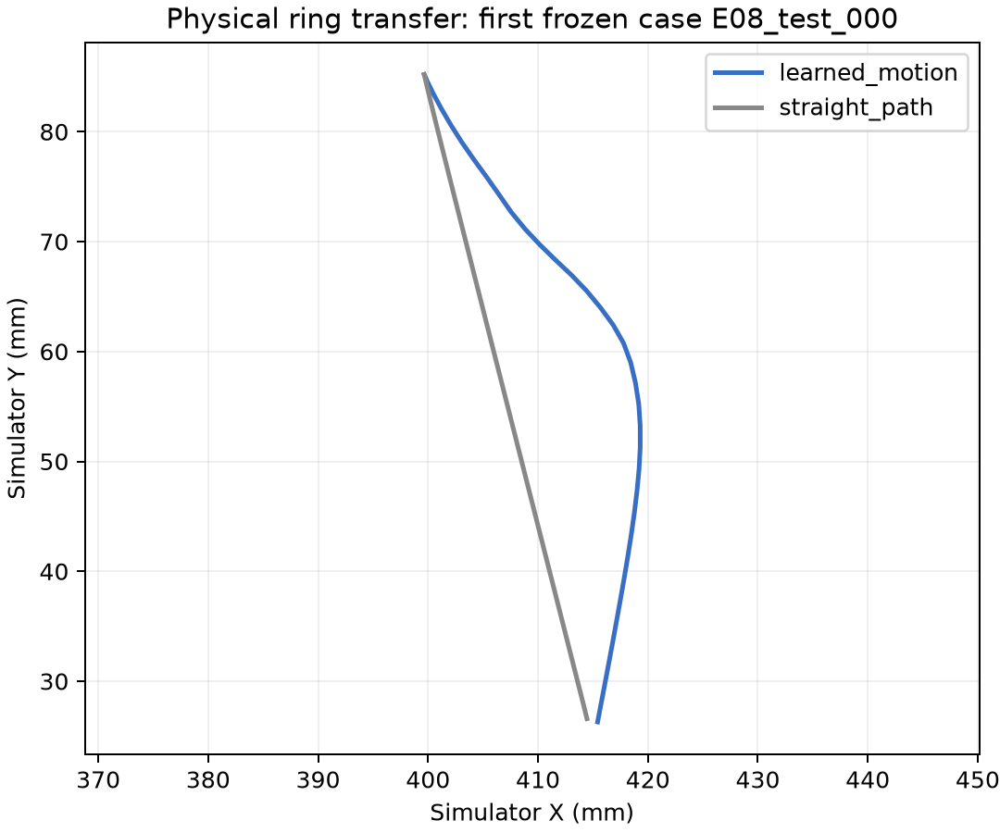
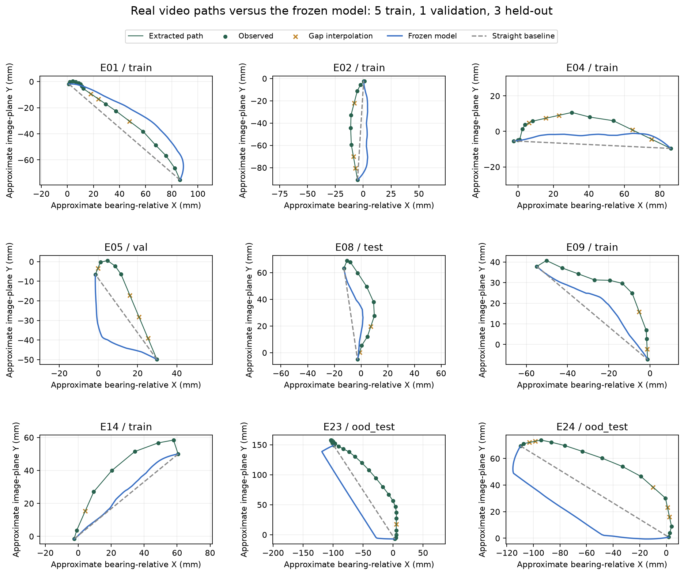

# Historical V3 baseline

Archived account: results, release status and original commands below belong to the recorded version. See the [current method](../method.md), [submission status](../submission.md) and [archive index](README.md). The original pipeline command below is retained; its current location is `scripts/archive/reproduce_v3.ps1`.

This preserves the earlier README and its negative trajectory result. V4 evidence is in the [spatial-generalization report](spatial_generalization.md); the root README describes the current experiment.

# Ring placement from a personally recorded phone video

This project uses a fixed-camera phone recording of a person moving a ring with tweezers to drive a simulated Panda arm. A **1,218-parameter network is trained directly on measured planar video motion**. It generates the robot's transfer path; geometric control supplies approach, grasp, vertical lift, lowering and release.

The final hybrid controller succeeds in **48/48 frozen simulated scenes**. An otherwise identical controller with a straight transfer path also succeeds **48/48**. The learned path changes physical motion, but does **not** improve placement success on this easy task. Prediction of the reserved human paths is worse than straight interpolation; the negative result is retained below.

[Watch the deterministic first-case demonstration](../../outputs/video_v3/student_demo.mp4), [inspect all rollout results](../../outputs/video_v3/evaluation/results.json), or [review the source motion overlays](../../outputs/motion/motion_review.mp4).



The left video panel is a visual comparison only. Human test frames are not fed to the robot controller.

## Challenge scope

The [Humanoid Robot Learning Research Intern challenge](https://jobs.ashbyhq.com/humanoid/e1a2a9de-ad23-4632-9d93-ee50fd41a221) asks for personally collected real data driving a robotic manipulator in simple simulation, with a public GitHub repository, runnable instructions, example outputs, design choices and successes/failures. Its examples include VLA, world models and retargeting, and it explicitly allows hand-coded solutions.

This implementation chooses planar motion learning and physical retargeting. It does not claim a VLA, a world model, calibrated 6D pose recovery or real-robot transfer. This is currently the **local submission version**; public GitHub publication was deferred at the applicant's request. See [the requirement checklist](../submission.md).

## What the real data contributes

The applicant recorded [359977334.mp4](../../data/source/359977334.mp4), 119.4 seconds, 720×1280 pixels. The phone stayed fixed; the bearing had three placements. Reset portions were removed and demonstrations concatenated. SHA-256: `90cfbb066d2d88c1794ee7f7d517715f50a72dda8abf7248624650d0d4ca0dd4`.

Twenty-four bounded episodes supply visible object endpoints and scene configurations. Nine also supply sufficiently visible, reviewed transfer motion. Fifteen complete motion paths are rejected, with reasons retained in [real_motion.json](../../data/real_motion.json). Rejected episodes are not replaced with straight synthetic trajectories.

| Motion split | Original usable paths | Observed points | Gap interpolation |
|---|---:|---:|---:|
| Training: E01, E02, E04, E09, E14 | 5 | 52 | 14 |
| Validation: E05 | 1 | 6 | 4 |
| Ordinary test: E08 | 1 | 10 | 2 |
| Reserved source group: E23, E24 | 2 | 38 | 6 |
| Total | 9 | 106 | 26 |

All descendants stay with their original source. The wider endpoint split remains 13 train / 3 validation / 3 test / 5 reserved; this is not a claim that all 24 episodes provide reliable motion supervision. Only 66 training points and 10 validation points train/select the trajectory network.

Dark ellipse contours and temporal prediction gates track the ring. Ring/shadow confusion caused E03 and E16 to be rejected. E05 frame 732 was rejected and its short missing bracket re-interpolated. [Visual review decisions](../../outputs/motion/visual_review.json) are replayable, source-hashed input to extraction. Green markers are observed; yellow markers are interpolated with zero observation confidence. The longest accepted interpolation bracket is eight source frames, approximately 0.267 seconds. Review playback is resampled at 10 fps, not the original timing.

Known bearing diameter supplies a local image scale; image Y is reversed for simulator coordinates. These are **approximate optical XY trajectories**, affected by perspective, ring height, tilt and shadow. Camera intrinsics, depth and force were not measured. Robot height, orientation, grasp contact, actuator commands and retiming are planned components.

## Model and retargeting

1. Normalize each measured path by cumulative planar arc length. Subtract its start-to-end straight line, rotate residuals into a local start-to-end frame, and divide by endpoint distance.
2. Feed progress and distance/0.1 m into a 2 → 32 → 32 → 2 ReLU network. It predicts longitudinal and lateral path residuals.
3. Apply a `4p(1-p)` envelope to enforce exact endpoints. Rotate back into the new scene, scale to metres and cap residual norm at 25 mm. Rotation/translation equivariance is analytical; it does not create additional independent recordings.
4. Follow this reference with bounded Cartesian displacement, shared IK, joint servos and contact physics. Transfer commands are capped at 2 mm per 50 ms step, or 40 mm/s. This is robot retiming, not learned human timing. The end is anchored to the hole center rather than copying an imperfect human release offset.

Training uses source-uniform weighted squared residual error and AdamW. Arc-cell quadrature reduces irregular source-time sampling bias; observed/interpolated base weights are 1/0.25, then each original source is normalized to unit total weight. Uncalibrated contour confidence is evidence, not a loss weight. Input statistics use training sources only.

The minimum validation-loss checkpoint is **epoch 9**, seed 20261014. It was saved before held-out trajectory metrics and physical tests. A provenance guard was then added; repeating training produced bit-identical weights, normalizer and selected epoch, recorded in [provenance_guard_verification.json](../../outputs/video_model/provenance_guard_verification.json). Final checkpoint SHA-256: `8a46863aa200b82726aee656e0732dc8ba0e00d7ea2f64f164af4f5eeedc0dea`.

Runtime inputs are start/goal geometry and progress; the network never reads a held-out human path. Other stages and transfer Z/gripper remain geometric. Rollouts distinguish transfer-scope steps from actual neural forward calls; deterministic endpoints are not counted as inference. This is a **hybrid controller**, not an end-to-end neural XYZ/gripper policy.

## Results and what did not work

The 48 V3 scene draws were frozen before V3 training. They descend from three ordinary and five reserved original endpoint sources, with planar rotation, relocation and 1 mm start jitter. Bearings lie within x=[0.40,0.52] m, y=[−0.10,0.10] m. These are correlated synthetic descendants of one edited recording, not 48 new real demonstrations or evidence of real-world generalization. V1/V2 outcomes informed the project design.

| Controller | Ordinary descendants | Reserved-source descendants | Total |
|---|---:|---:|---:|
| Video-trained transfer + planned grasp/release | 18/18 | 30/30 | 48/48 |
| Same controller with zero residual/straight transfer | 18/18 | 30/30 | 48/48 |

Strict success requires the full ring projection inside the hole with 0.3 mm margin, tilt ≤8°, table height within 1.5 mm, linear speed <0.01 m/s, angular speed <0.15 rad/s, open fingers, no finger contact and ≥0.4 s settling. All attempted scenes remain in the denominator. [Raw rollouts](../../outputs/video_v3/evaluation/rollouts.json) include steps, phases, contacts and physical transfer paths.

The model changes executed paths: mean maximum physical lateral deviation from each transfer's endpoint line is **15.51 mm**, versus **0.041 mm** for straight control. This establishes a data-to-motion effect, not a performance improvement. [Path contribution report](../../outputs/video_v3/analysis/path_contribution.json).



Real-path prediction is weaker:

| Human path split | Model mean displacement | Straight interpolation |
|---|---:|---:|
| Training, 5 paths | 9.45 mm | 9.95 mm |
| Validation, 1 path | 17.05 mm | 9.06 mm |
| Ordinary test, 1 path | 9.28 mm | 12.74 mm |
| Reserved group, 2 paths | 40.79 mm | 21.81 mm |

These source-uniform weighted errors compare predictions with extracted/interpolated **image-plane paths**, not calibrated pose ground truth. The model improves the ordinary test example but fails to generalize to the reserved group. The easy task still succeeds because grasp/release are planned and the endpoint is constrained. Task success therefore does not demonstrate faithful human-motion imitation.

Tiny supervision, uncertain lifted-object projection and the shared canonical-shape assumption are plausible limitations, not separately proven causes. More reviewed training motion and a direction/style-conditioned model are next experiments; they were not tuned using these final held-out results.



## Physics and dimensions

| Object | Outer diameter | Inner diameter | Height |
|---|---:|---:|---:|
| Bearing | 50 mm | 40 mm | 5 mm |
| Ring | 25 mm | 20 mm | 7 mm |

Both start flat. Custom narrow fingers pinch the 2.5 mm ring wall. Annular convex-wedge meshes preserve the holes. The ring is a free body with contact grasping: no weld, attachment or object teleport after reset. It rests on the table inside the bearing and protrudes 2 mm above it. Mass, friction, gravity compensation and fixed downward tool orientation are simulator assumptions.

Panda assets are from MuJoCo Menagerie revision `d7b481bac63d3d600ab404ee74f7474c5efe8a67`. Apache-2.0 attribution is in [vendor/NOTICE.md](../../vendor/NOTICE.md); project code is MIT licensed. No real robot has been tested.

## Reproduce

Tested on Windows with Python 3.12, MuJoCo 3.12.0 and PyTorch 2.14.0+cpu. CPU is sufficient. ffmpeg/ffprobe must be on PATH for video encoding. Run commands from the repository root. The original video and required assets are included.

```powershell
python -m venv .venv
./.venv/Scripts/python.exe -m pip install torch==2.14.0 --index-url https://download.pytorch.org/whl/cpu
./.venv/Scripts/python.exe -m pip install -r requirements.txt
./.venv/Scripts/python.exe -m pytest -q
```

Evaluate the delivered model and replay the first frozen case:

```powershell
./.venv/Scripts/python.exe -m ring_learning.video_evaluate --output outputs/recheck_v3
./.venv/Scripts/python.exe -m ring_learning.video_demo --output outputs/recheck_v3/student_demo.mp4
```

Regenerate measurements in separate destinations:

```powershell
./.venv/Scripts/python.exe -m ring_learning.extract --output outputs/reproduced_endpoints.json --output-dir outputs/reproduced_endpoints --visual-review outputs/extraction/visual_review.json
./.venv/Scripts/python.exe -m ring_learning.motion --output outputs/reproduced_motion.json --output-dir outputs/reproduced_motion --visual-review outputs/motion/visual_review.json
```

The motion command uses the included reviewed endpoint file and verifies its exact source hash. Replacing endpoints requires regenerating motion and recording the new lineage. A stale motion/endpoint pairing is rejected by training.

For a full **raw video → new endpoints → new motion → new model → 48 scenes → demo** reproduction, use the script below. It passes regenerated files through every stage, freezes scenes before training and refuses to overwrite an earlier output directory:

```powershell
./scripts/reproduce_v3.ps1 -OutputDirectory outputs/full_reproduction
```

It replays the included visual review decisions; it does not substitute new human review or new recordings. Reproduced metadata/checkpoint hashes can differ because paths/provenance change even when weights are identical.

Retrain and evaluate without overwriting the selected checkpoint or frozen scenes:

```powershell
./.venv/Scripts/python.exe -m ring_learning.video_train --output outputs/retrained_video_model
./.venv/Scripts/python.exe -m ring_learning.video_evaluate --checkpoint outputs/retrained_video_model/policy.pt --output outputs/retrained_v3_evaluation
./.venv/Scripts/python.exe -m ring_learning.video_demo --checkpoint outputs/retrained_video_model/policy.pt --output outputs/retrained_v3_evaluation/student_demo.mp4
```

To freeze another simulation draw, use `video_evaluate --prepare --seed 20261018 --manifest outputs/new_protocol/configurations.json` before training; existing manifests cannot be overwritten. Included final scenarios should be reused to reproduce the reported result.

Optional plots:

```powershell
./.venv/Scripts/python.exe -m pip install -r requirements-plots.txt
./.venv/Scripts/python.exe -m ring_learning.video_analysis --output outputs/recheck_v3/analysis
```

Linux uses `.venv/bin/python` and needs suitable MuJoCo OpenGL/EGL/OSMesa configuration; rendering verification here is on Windows. [Clean-clone verification](reproduce_video.md) records the tested revision, isolated package paths and command outcomes.

## Historical baseline and files

V1 used video endpoints and synthetic teacher actions. Its ordinary/third-point result was 18/18 and 6/30; those diagnostics informed V2 augmentation and train-only DAgger. V2's 19,844-parameter full action student achieved 46/48. It used real scene geometry but did not learn human motion. These artifacts remain available and are **not V3 results**. See [V2 method and commands](behavior_cloning.md).

Main deliverables: `data/source`, `data/real_episodes.json`, `data/real_motion.json`, `outputs/motion`, `outputs/video_model`, `outputs/video_v3`, runnable `ring_learning` code, tests and attributed `vendor/panda` assets. Source/checkpoint/environment bindings detect stale combinations. Clutter, tilted starts, unknown objects, unobserved grasp styles and real-robot transfer remain untested.
