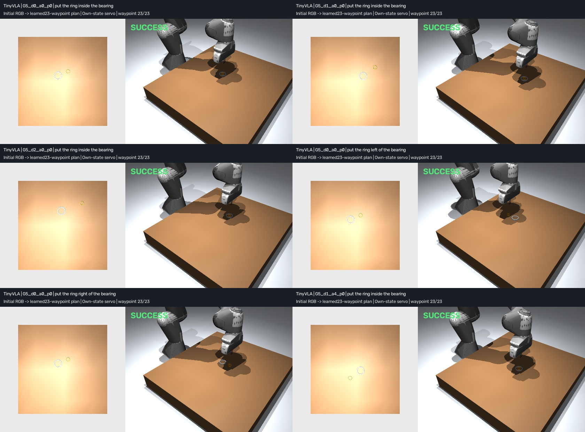
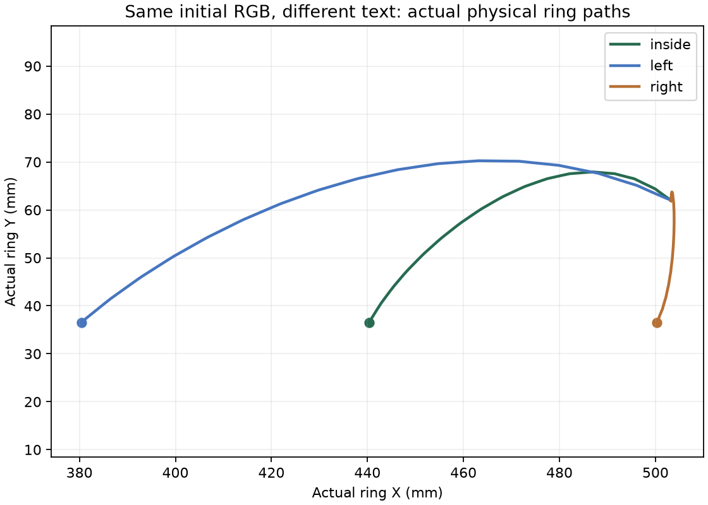

# Historical V5 baseline

Archived account: results, release status and original commands below belong to the recorded version. See the [current method](../method.md), [submission status](../submission.md) and [archive index](README.md). The original full-pipeline command below is retained; its current location is `scripts/reproduce.ps1`. The V4 precursor script is now `scripts/archive/reproduce_v4.ps1`.

Preserved before adding the video-motion ablation. Current results are in the root README.

# TinyVLA: recorded ring motion to visual-language robot actions

V5 is a **33,930-parameter task-specific VLA**: initial tabletop RGB and a text instruction generate23 XYZ/gripper action waypoints, executed by a physical Panda arm with a proprioceptive waypoint servo. Its learned vision, word embeddings and action head are trained from scratch. It is a minimal hierarchical VLA, **not SmolVLA fine-tuning or a pretrained general-purpose VLA**.

The existing personally recorded phone video supplies scene geometry and optical transfer motion through the preserved train-only V4 precursor. Robot RGB, heights, grip values and left/right demonstrations are generated in simulation. The visual encoder is **not trained directly on the original phone RGB**. This distinction and all execution conventions are documented in [the method](../method.md).

[Watch six preset physical replays](../../outputs/vla_v5/student_demo.mp4) · [All264 outcomes](../../outputs/vla_v5/evaluation.json) · [Frozen model/protocol](../../outputs/vla_v5/model_freeze.json) · [中文说明](../results_zh.md)



## Results: spatial generalization and actual modality use

Freeze a new seed20261024 before testing:96 combinations of object positions, eight start-to-goal direction bins and45–160mm distances. Both object dimensions and a fixed camera remain unchanged. No test outcome changes weights, model selection or code.

| Experiment | Successes / all attempts |
|---|---:|
| Initial RGB + “put the ring inside the bearing” | **96/96** |
| Same96 scenes and weights, image replaced by zeros | **0/96** |
| Same24 scenes, inside/left/right instructions | **72/72** |

The72 language attempts include24 repeated inside trials; they are counterfactual/repeat controls, not72 independent new scenes. Each command succeeds24/24. In all24 paired scenes the RGB is identical but the neural waypoint chunk changes by approximately60mm to the instructed side. The repeated inside chunks and complete physical trajectories are bit-identical. All96 black-image cases complete the same23-waypoint execution and fail target scoring; none is discarded or rescued.

Every main distance band is32/32 and every direction bin12/12. Main actual ring-center placement error: mean **0.507mm**, maximum **1.123mm**. All264 controllers finish, with one neural inference per episode, zero execution exceptions and zero forbidden object/phase/teacher accesses through the restricted runtime interface. [Saved-record verification](../../outputs/vla_v5/analysis/verification.json).



These tests establish **fixed-camera, same-object simulated spatial generalization and finite command grounding**. Training rotations already span360°, so new directions mean new draws/combinations, not a withheld angular sector. Training video distances extend past160mm; the test includes short-distance extrapolation plus combinations within support. V4 already succeeded at placement; V5 has no demonstrated success-rate advantage over that geometric-assisted baseline.

## Model input, output and execution boundary

- RGB: fixed256×256 orthographic full-tabletop pass, calibrated span560mm. Robot geometry is hidden in this declared special pass; the camera does not follow objects or use object-centered crops. Wide demonstration views show the arm.
- Text: nine registered English phrases covering inside,60mm left and60mm right in table X. Learned word embeddings and a nonlinear text head condition action coefficients. There is no runtime language-to-geometry action branch or intent-ID input. Unknown phrases are rejected; open language/Chinese understanding is not claimed.
- Vision: a small CNN predicts two foreground maps. Squared-sigmoid centroids plus known camera calibration estimate ring/bearing XY; training masks and true coordinates never enter runtime inference.
- Action:23 learned absolute XYZ/gripper targets. A generic hand-coded executor uses its own tool/command positions, waypoint reach tolerances and hold durations, then sends bounded deltas through unchanged IK, servos and contact physics. It does not read ring/bearing truth, environment phase, contacts, teacher actions or scoring.

The plan is generated once from the initial RGB; subsequent feedback is proprioceptive. This is **hierarchical VLA with a waypoint executor**, not fully learned per-step or visually replanning control. Task decomposition, camera calibration, downward orientation, IK and scheduling are planned conventions. True object state is used for training labels and scoring only. The original oracle stage FSM is removed from V5 physical execution.

## Source data, training and failed designs

The applicant recorded [359977334.mp4](../../data/source/359977334.mp4),119.4s,720×1280,3,581 frames. Fixed phone, three bearing placements, edited resets. Video SHA256: `90cfbb066d2d88c1794ee7f7d517715f50a72dda8abf7248624650d0d4ca0dd4`.

The preserved original split remains13 train /3 validation /3 test /5 reserved. Video measurements and reviewed annotations were produced with assistant support. V4's real-motion model uses only the13 training sources. V5 renders16 descendants per training source (**208 scenes**) and8 per validation source (**24 scenes**), all source-isolated. [Dataset manifest](../../outputs/vla_v5/dataset/manifest.json) binds the video, precursor, arrays, camera and generation code. [Training record](../../outputs/vla_v5/model/training.json).

Source-uniform least squares fit the action coefficient targets. Actual word embeddings/nonlinear text features are trained, then the final linear layer is refined against training phrase targets. The visual network trains with segmentation and center losses. **Validation selects epoch146 of240**, on RTX5080, in58.16s. No test labels or poses tune weights.

| Held-out source validation,24 scenes | Mean | Maximum |
|---|---:|---:|
| RGB → grasp XY | 0.376mm | 0.850mm |
| RGB → goal XY | 0.637mm | 0.922mm |
| True-coordinate text/critical waypoint error | <0.001mm | <0.001mm |
| RGB → whole action chunk XYZ, against synthetic labels | 1.224mm | 6.703mm |
| True-validation-coordinate decoder → whole-curve XYZ | 0.908mm | 6.956mm |

Physical validation is24/24 for each of the three primary commands (72/72). Endpoint precision does not imply exact reproduction of intermediate human motion. At256px across560mm, exact segmentation centroids themselves have about0.5mm mean raster error; sub0.2mm localization everywhere is not claimed.

The first mean-word/linear text head failed to handle different-length aliases; the second gradient-only head retained accumulated coefficient error. These validation-only attempts are preserved under `model/attempt_01` and `attempt_02`; their outdated bindings are archival, not usable deployment checkpoints. Nonlinear text features and train-only last-layer refinement fixed the issue before testing. Existing V4's worse-than-straight human-path result remains [documented](spatial_generalization.md).

Final checkpoint SHA256: `412d3f45dafdd47630000c61527c4056e1d8975c01a1a30fc931ec6810dc4452`. CPU Torch2.11/2.14 outputs agree bitwise for24 validation images; GPU/CPU XYZ differences are at most0.016mm. [Portability evidence](../../outputs/vla_v5/model/portability.json).

Independent clean-source re-training regenerates byte-identical data and all model tensors. Full264-attempt reproduction using CPU Torch2.11 matches every success decision and execution step count from the original CPU Torch2.14 run. Across these versions the maximum absolute waypoint XYZ component difference reaches0.000507mm and final ring-position distance difference0.0644mm; physical trajectories are not claimed to be bit-identical. [Reproduction evidence](../reproduce.md).

## Run the delivered model

The original CPU environment remains supported for inference. Python3.12, NumPy2.5.2, MuJoCo3.12.0, Torch2.14.0+cpu, OpenCV5.0.0.93 were checked. ffmpeg/ffprobe must be on PATH for video.

```powershell
python -m venv .venv
./.venv/Scripts/python.exe -m pip install torch==2.14.0 --index-url https://download.pytorch.org/whl/cpu
./.venv/Scripts/python.exe -m pip install -r requirements.txt
./.venv/Scripts/python.exe -m pytest -q
./.venv/Scripts/python.exe -m ring_learning.vla_evaluate run --manifest outputs/vla_v5/configurations.json --receipt outputs/vla_v5/model_freeze.json --out outputs/vla_recheck.json
./.venv/Scripts/python.exe -m ring_learning.vla_demo --output outputs/vla_recheck_demo.mp4
```

Frozen receipts and reports are immutable; choose new output paths. The supported primary strings are:

```text
put the ring inside the bearing
put the ring left of the bearing
put the ring right of the bearing
```

## Retrain and reproduce

GPU training used a separate local `.venv-vla` inheriting installed Anaconda Torch2.11.0+cu128, with local MuJoCo/OpenCV/NumPy. It leaves V4 intact but is not a fully isolated GPU dependency environment; inherited unused packages report dependency conflicts. Actual imports, CUDA operations and CPU portability were checked. The actual inherited Pillow was12.1.1; the fresh-install requirements pin12.3.0. A fresh dedicated GPU installation can use:

```powershell
python -m venv .venv-vla
./.venv-vla/Scripts/python.exe -m pip install torch==2.11.0 --index-url https://download.pytorch.org/whl/cu128
./.venv-vla/Scripts/python.exe -m pip install -r requirements-vla.txt
./scripts/reproduce_vla.ps1 -OutputDirectory outputs/full_vla_reproduction -Device cuda
```

The script regenerates source-isolated RGB/action data, trains240 epochs, freezes model/scenes, reruns all264 attempts and produces six preset clips. CPU training is available with `-Device cpu`, with a different runtime. It uses the delivered train-only V4 motion precursor; raw-video rebuilding of that precursor is separately available through `scripts/reproduce_v4.ps1`. Supplied optical annotations are reused. [Clean-source reproduction report](../reproduce.md).

Optional plots use `requirements-plots.txt` and `python -m ring_learning.vla_analysis`.

## Scope, challenge and licensing

Ring OD25/ID20/height7mm; bearing OD50/ID40/height5mm. Both start horizontal. Narrow custom fingers pinch the2.5mm wall. The ring is a free body, with no weld, attachment or teleport after reset. Friction, mass, fixed appearance and tool orientation are assumptions.

Phone-image perception, new cameras/backgrounds, real robot occlusion, new dimensions/materials, friction variation and hardware transfer remain unverified. The special robot-hidden simulator image must not be represented as an ordinary real camera. A minimal finite-command VLA is not a pretrained foundation model; see [official SmolVLA](https://huggingface.co/docs/lerobot/smolvla) for that separate450M route.

This addresses the technical data-to-manipulator scope of the [Humanoid intern challenge](https://jobs.ashbyhq.com/humanoid/e1a2a9de-ad23-4632-9d93-ee50fd41a221). Hand-coded solutions are allowed. **Public GitHub publication remains deferred by the applicant**, so that submission requirement is outstanding; no application was submitted. [Checklist](../submission.md).

Code MIT; Panda assets Apache2.0 with [attribution](../../vendor/NOTICE.md). Earlier versions remain intact: [V4](spatial_generalization.md),[V3](video_policy.md),[V2](behavior_cloning.md).
