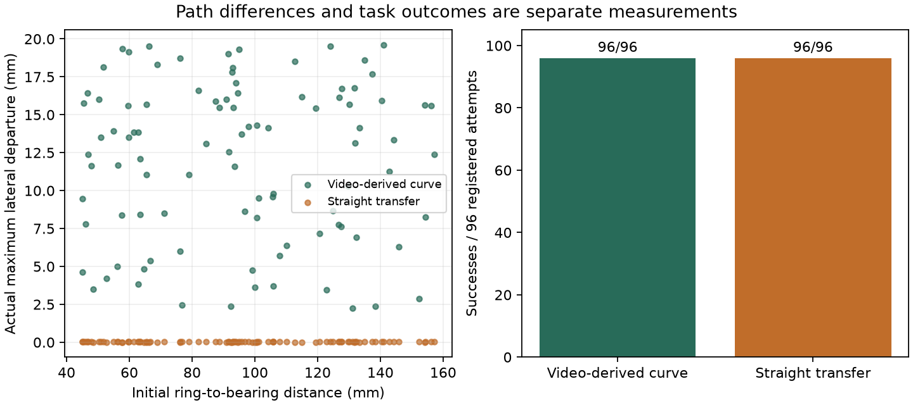

# Curved and straight transfer

The V5 black-image and instruction controls show that the model uses RGB and text. They do not isolate the contribution of the recorded transfer motion. This comparison removes that curvature while keeping the rest of the policy fixed.

The straight condition retains the video-derived endpoint geometry. It is a partial motion ablation, not a model trained without real data.

## Intervention

Both models start from the delivered 33,930-parameter V5 checkpoint. The straight readout is fitted only on the 208 TRAIN scenes, with the original source-uniform least squares and nine training phrases. Only the 300 final-layer coefficient rows for intermediate transfer XY are replaced. All other rows, visual/text features, camera buffers, grasp/endpoints, Z and grip keep their original bytes.

The new fit has no epochs or validation-based selection. It inherits V5's selected visual model. The training-only straight residual is below 0.001 mm; this is a model-fit diagnostic, not a real-camera precision claim.

## Fixed evaluation

Seed 20261028 fixes 96 new configurations: three distance bands, eight transfer directions and four placements per cell. Each scene runs once with the video curve and once with straight transfer. All 192 attempts, including exceptions and timeouts, remain in the denominator. CPU Torch 2.14 and two threads are used for both variants.

One initial RGB is captured after resetting a scene and before either trial. Both policies receive a copy of that same image; their own robot-state feedback stays live. The image archive records what actually entered each policy.

The first implementation independently rendered each trial. Its seed 20261027 run completed all 192 attempts but failed the exact-observation control in one pair. Repeated rendering of an identical scene changed three background channel values by one gray level, without changing model outputs. Those records are retained; the fix changes observation sampling and the test seed, not learned weights or success thresholds.

The two checkpoints, training data, source files, physical assets, scene list and protocol are frozen before execution. Both controllers see the same initial image and instruction. True object state is used for logging and grading, not action generation.

Path metrics use the executor's pre-call waypoints 4..19 window, including the preceding state and final post-action state. They measure actual ring motion. Airborne and finger-contact fractions are logged separately; failed grasps are not filtered away. A stationary path has no arc/chord ratio. Duration means steps × 0.05 s of simulated time.

The analysis independently checks paired observations/common actions and resamples paths by arc length before comparing shapes. Different-duration paths are not compared by matching step indices. Plot scenes 0/32/64 are fixed in advance.

## Results

The corrected seed 20261028 run completed all 192 registered attempts. All 96 pairs received identical saved RGB, and their grasp/endpoints, Z and grip predictions were exactly equal. Only intermediate transfer XY changed. No forbidden state access or execution exception was recorded.

| Measurement | Video-derived curve | Straight transfer |
|---|---:|---:|
| Successful / registered attempts | 96/96 | 96/96 |
| Mean actual ring transfer path length | 100.59 mm | 94.32 mm |
| Mean maximum departure from each path's endpoint chord | 11.91 mm | 0.029 mm |
| Mean path length / endpoint chord length | 1.0821 | 1.0001 |
| Mean simulated transfer duration | 4.174 s | 3.982 s |
| Mean final center error | 0.567 mm | 0.567 mm |

All 96 trajectories per condition are included. Every logged transfer sample was airborne under the declared Z threshold and had finger contact. Path shapes were matched at 100 equally spaced arc-length fractions; the mean paired RMS separation was 8.95 mm. This compares simulated paths, not reconstructed human 3D motion. Physical final positions were slightly different despite shared final action labels: the largest paired XY difference was 0.0475 mm.

The video-derived motion survives neural prediction and physical execution. It does not improve success on this wide-clearance task, and its mean path and simulated duration are longer. The straight condition retains recorded endpoint geometry and inherited V5 perception, so this experiment cannot establish whether the project would work without any real data. The old V4 reserved-human-path comparison also favored straight interpolation; that negative result remains in the baseline report.




New code keeps fitting, physical execution and saved-record analysis in separate modules and reuses the V5 controller, physics runner and outcome summary. The original six V5 modules are preserved. The 34 new tests cover the intervention, paired inputs, tamper detection, failure denominators and trajectory analysis; all 281 tests passed in the separate source clone.

The clone regenerated a byte-identical straight checkpoint and fit report, then replayed only the first predetermined pair. This is an automated same-host reproduction, not a second full 192-attempt benchmark or new human recordings. See the [reproduction scope and evidence](reproduce_motion.md).

[Complete rollouts](../outputs/motion_ablation_v6_final/evaluation.json), [independent analysis](../outputs/motion_ablation_v6_final/analysis/verification.json), [aggregate metrics](../outputs/motion_ablation_v6_final/aggregate_metrics.json), [freeze receipt](../outputs/motion_ablation_v6_final/freeze_receipt.json), [shared observations](../outputs/motion_ablation_v6_final/evaluation.initial_rgb.npz) and [unchanged-tensor check](../outputs/motion_ablation_v6_final/observer_fix_weight_check.json) are retained.

## Reproduce

```powershell
./scripts/compare_motion.ps1 -OutputDirectory outputs/new_motion_ablation -Plots
```

Plots require `requirements-plots.txt`. The script prepares and freezes both variants, then runs the registered schedule. It refuses an existing output directory.

[Protocol](superpowers/specs/2026-10-14-motion-ablation-design.md), [baseline-fit code](../ring_learning/motion_ablation_model.py), [physical runner](../ring_learning/motion_ablation.py), [independent analysis](../ring_learning/motion_ablation_analysis.py), [V5 evidence](archive/vla_baseline.md).
