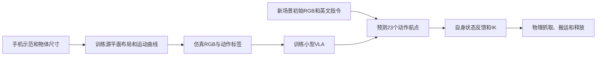
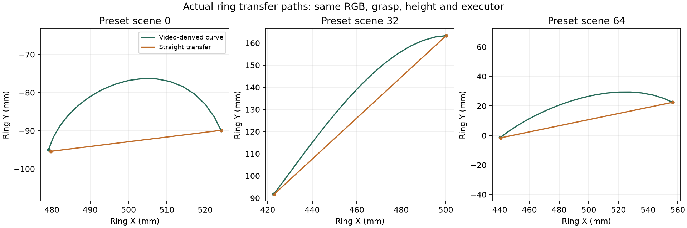

# 实现与实验结果

项目用现有手机视频，让仿真Panda机械臂抓起戒指并放入轴承。V6增加了一个直接的对照：保留相同图像、抓取点、终点和执行器，只把视频导出的弯曲搬运轨迹改成直线。两版都成功96/96，因此这次实验支持“视频改变了机器人运动”，没有支持“弯曲轨迹让任务更容易成功”。

## 数据怎样进入模型

原视频119.4秒，分成24条示范。手机固定，轴承有三个位置，重置过程已剪掉，没有相机标定。戒指外径25、内径20、高7毫米；轴承外径50、内径40、高5毫米。尺寸帮助建立近似平面坐标，视频没有提供完整的三维机器人动作真值。

13条训练示范先用于拟合二维搬运曲线，再生成208个仿真训练场景。另3条源示范生成24个验证场景，按原始示范隔离。图像、分割标签和动作航点来自仿真；高度、夹爪时序及左右放置标签由程序规定。视觉网络直接训练的是仿真RGB。

模型有33,930个参数，输入一张256×256初始RGB及英文指令，输出23个XYZ／夹爪航点。CNN估计物体位置，文字动作头生成轨迹；程序负责航点跟踪、停留和IK。执行器只读取机器人自身状态，物体真值用于记录和评分。它支持9个固定英文短句，对应放入轴承、轴承左侧60毫米和右侧60毫米，后续没有视觉重规划。

## 新位置、方向和距离

原V5冻结模型后测试96个新布局，覆盖8个搬运方向和45–160毫米距离。正常图像成功96/96；相同场景遮黑输入图像后0/96；在24个场景切换放入／左侧／右侧指令，成功72/72，其中24次放入是主任务重复。主任务最终中心误差平均0.507毫米、最大1.123毫米。

这些结果说明模型在固定仿真条件下使用图像和文字，并适应未见过的布局组合。训练旋转已覆盖360度，原训练距离也超过160毫米，因此未验证保留角度扇区或更长距离外推。“方向”指搬运方向；圆环的绕竖直轴朝向没有可区分的几何变化。

## 视频曲线和直线搬运

V6先冻结新种子20261028、96个场景及192次测试安排，再运行两组。直线版只用训练集重拟合中间搬运XY；其余权重、抓取和终点、Z与夹爪输出保持一致。每对试验共享同一张已保存初始图像，全部96对的图像和共同动作均通过严格一致性检查。

| 测量 | 视频曲线 | 直线搬运 |
|---|---:|---:|
| 成功／全部尝试 | 96/96 | 96/96 |
| 戒指实际搬运路径长度均值 | 100.59毫米 | 94.32毫米 |
| 每条路径最大侧向偏离的均值 | 11.91毫米 | 0.029毫米 |
| 搬运阶段仿真耗时均值 | 4.174秒 | 3.982秒 |
| 最终中心误差均值 | 0.567毫米 | 0.567毫米 |

侧向偏离相对每条路径起终点连线计算。记录的是戒指实际运动，所有尝试保留；搬运窗口内全部记录点都满足离桌阈值并有手指接触。两组按弧长对齐后的轨迹RMS距离平均8.95毫米。视频曲线被执行出来，但在这个间隙较大的任务上更绕、略慢。直线版仍保留视频的端点布局，不能解释成“完全不需要真实数据”。

## 失败、复现和边界

两个早期文字动作头未达到验证要求，已保留失败权重。V4拟合曲线在预留真人路径上也没有优于直线。V6第一次测试虽两组均96/96，但独立重复渲染让一对图像的三个背景通道变化一个灰度级，违反图像一致性要求。该次完整记录保留；修正为每对共享单次采样图像后，用新场景重新冻结测试，模型参数未改。

新代码把训练干预、物理运行和结果分析分开，复用原控制器、物理执行和结果汇总，保留已冻结的V5模块。独立代码副本通过281项测试，重新生成的直线模型和拟合报告逐字节一致；只重放首个预定场景的一对，不算额外192次实验。原V5另有完整264次复现，跨PyTorch版本的成功判定一致，最终戒指位置最大差0.0644毫米。

尚未验证手机真实RGB控制、新相机、遮挡、新物体、不同材质或实机。当前相机固定顶视且隐藏机器人几何，模型只看初始图像。下一步最有价值的是补真实图像感知和在线视觉反馈，并在有障碍或更小间隙的任务中检验曲线是否有用。

申请者提供了任务、手机录像和物体尺寸；AI辅助分析、代码、实验和写作。这里保留贡献说明和真实失败，不虚构个人调试经历。代码、数据和实验记录已放入[公开仓库](https://github.com/MingxS-cs/ring-placement)，申请表尚未提交。

[英文运行命令](../README.md)、[V6完整测试](../outputs/motion_ablation_v6_final/evaluation.json)、[V6对照细节](motion_comparison.md)、[V6复现范围](reproduce_motion.md)、[V5方法](method.md)、[V5复现](reproduce.md)和[AI贡献说明](contributions.md)。
