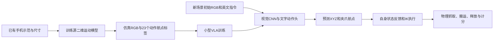

# 小型VLA版本与泛化结果

这一版是任务专用的最小VLA：约3.4万参数，输入初始桌面RGB和文字，输出23个XYZ与夹爪动作航点。模型包含学习的图像CNN、词嵌入和动作头。执行器根据机器人自己的末端位置跟踪航点，不读取戒指或轴承真值，不调用教师动作。阶段安排、停留时间和IK仍由程序实现；它不是预训练通用VLA，也不是全流程逐步神经控制。

现有手机视频提供布局和近似二维搬运曲线。先用已有训练专用V4模型拟合视频运动，再生成仿真图像和机器人动作标签，训练VLA。视觉网络没有直接用原手机RGB训练；高度、夹爪和左右放置任务都是合成标签。208个训练场景来自13条原示范，24个验证场景来自另外3条，按原示范隔离。

冻结模型后，新抽样的96个场景覆盖新位置、八个方向及45–160毫米距离。结果如下：

这里的方向指戒指到轴承的平面搬运方向；本任务的圆环绕竖直轴旋转后具有相同几何形状，因此不是非对称物体朝向识别测试。

| 测试 | 成功 / 全部尝试 |
|---|---:|
| 图像＋“放入轴承” | **96/96** |
| 相同场景和权重，图像全部遮黑 | **0/96** |
| 同24场景换成放入／左侧／右侧指令 | **72/72** |

语言对照包含24次主任务重复，不算新的独立场景。相同RGB换指令后，模型航点向左右改变约60毫米，实际戒指也到达对应目标。全部264次都执行完23个航点，没有教师救援或禁止的真值访问。主任务最终中心误差平均0.507毫米，最大1.123毫米。

当前支持9个固定英文短句，对应放入、左侧、右侧三类；不具备自由中文或开放语言理解。图像来自固定顶视仿真相机，并通过声明的渲染方式隐藏机器人几何，便于观察物体。模型只看一次初始图像，后续是机器人自身状态反馈跟踪。因此，手机真实图像、新相机、背景、遮挡、新物体和实机泛化仍未验证。

两次失败设计已保留：线性文字头无法正确处理不同词数的同义指令；仅梯度拟合的动作系数也有残差。验证集发现问题后，在正式测试前完成修正。最终训练240轮，验证选择第146轮；现有GPU用时约58秒。全部247项代码测试通过。

独立代码副本重新生成的数据和重新训练的全部权重逐字节一致，完整264次测试的成功判定与执行步数也全部复现。原测试和复现使用不同CPU PyTorch版本，因此部分浮点动作及物理轨迹不逐位一致；最终戒指位置最大差约0.064毫米。详细环境、数值差异及复现证据见[复现报告](reproduction_vla.md)。这次复现重复原场景，不增加独立测试样本数。

训练旋转已覆盖360度，所以本次是未见过的具体方向和位置距离组合。原视频训练距离超过160毫米，因此不是向更长距离外推。原V4也能完成放置，当前没有放置成功率提升证据；新增证据是模型确实依赖图像和文字生成并完成相应动作。

[完整报告](../outputs/vla_v5/evaluation.json)、[模型冻结记录](../outputs/vla_v5/model_freeze.json)、[六个预选演示](../outputs/vla_v5/student_demo.mp4)、[英文运行命令](../README.md)和[方法细节](tiny_vla_method.md)均保留。本地提交方式延续你的决定，未公开GitHub或提交申请。
