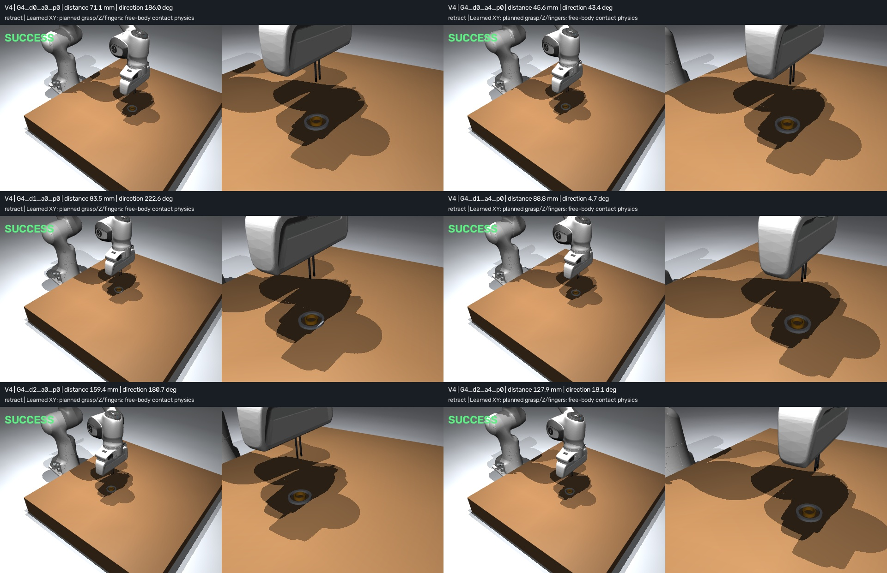
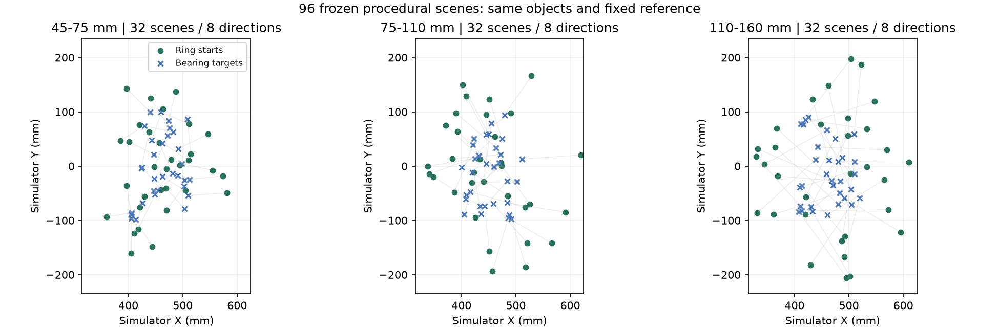
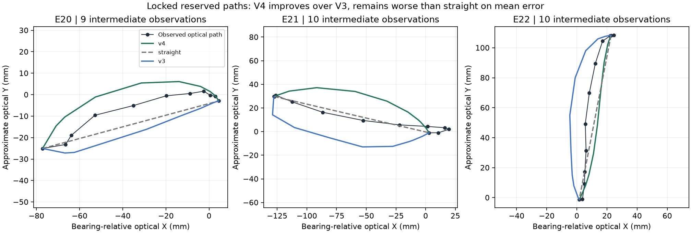

# Historical V4 baseline

Preserved before adding the TinyVLA experiment. See the root README for current results.

# Ring placement: phone data to a generalizing simulated manipulator

A personally recorded fixed-camera phone video supplies measured ring motion. **V4 trains a 12-coefficient, direction-conditioned trajectory model** on real observations and executes its XY reference with a contact-based Panda arm. Geometric control supplies grasp, height, fingers and release.

The hybrid controller completes **96/96 frozen scenes**, covering new positions, eight directions and 45–160 mm distances. Straight control and the frozen V3 profile also complete **96/96** under identical execution. Learned motion changes the physical path but does not improve placement success. On three newly annotated reserved human paths, V4 improves over V3 and remains worse than straight interpolation. Both findings are retained.

[Six preset scene replays](../outputs/generalization_v4/student_demo.mp4) · [Physical results](../outputs/generalization_v4/evaluation/results.json) · [Held-out fidelity](../outputs/generalization_v4/fidelity/fidelity.json) · [Detailed method](../docs/generalization_v4.md)

[中文结果说明](../docs/generalization_results_zh.md)



## Challenge and scope

The [Humanoid Robot Learning Research Intern challenge](https://jobs.ashbyhq.com/humanoid/e1a2a9de-ad23-4632-9d93-ee50fd41a221) asks for personally collected data driving a manipulator in simple simulation, runnable instructions, example outputs, design choices and successes/failures, in a public GitHub repository. It allows hand-coded solutions; VLA, world-model and retargeting approaches are examples. No push-block task is mandated.

This is the **local submission version**. The applicant explicitly deferred public GitHub publication, so the public-repository requirement remains outstanding. CV, eligibility and application submission are separate. [Requirement checklist](../docs/challenge_checklist.md).

Demonstrated generalization is **same-task, same-object motion control in simulation with known positions and a fixed reference**. Runtime positions come from simulator state. Visual recognition in new scenes, calibrated 3D, unfamiliar objects and real-robot transfer are not established.

## Real data and supervision

The applicant recorded [359977334.mp4](../data/source/359977334.mp4): 119.4 s, 720×1280 pixels, approximately 30 fps, 3,581 frames. The phone stayed fixed; the bearing had three placements. Resets were removed and demonstrations concatenated. Video SHA-256: `90cfbb066d2d88c1794ee7f7d517715f50a72dda8abf7248624650d0d4ca0dd4`.

Twenty-four bounded episodes supply visible endpoints. V4 preserves the original 13 train / 3 validation / 3 test / 5 reserved source split. Reviewed manual centers recover visible motion in eight previously rejected training episodes and all three validation episodes. Missing observations are never replaced with synthetic straight supervision.

The applicant supplied the recording; centers were visually annotated with assistant support. Native evidence is included for applicant/reviewer inspection.

| V4 source group | Paths | Observations | Explicit gap interpolation |
|---|---:|---:|---:|
| Retained original training paths | 5 | 52 | 14 |
| Additional manual training paths | 8 | 110 | 0 |
| Validation, manual replacement | 3 | 40 | 0 |
| Newly annotated reserved E20/E21/E22 | 3 | 35 | 0 |

Only **176 points across 13 training paths** fit the model. Validation is diagnostic. The 35 reserved observations (29 intermediate) stay sealed until weights, selection protocol and physical scenes are frozen. These are windows of the same recording with prior endpoint exposure, not independent recordings. Earlier V3 tests informed this redesign; they are not relabeled as fresh tests.

[Development labels](../data/v4_development_annotations.json), [native proof verification](../outputs/v4_development_review/verification.json), [blind receipt](../outputs/v4_holdout_review/freeze_receipt.json), and [model freeze](../outputs/generalization_v4/model_freeze.json) preserve provenance. New manual proof images match sequential decoding. E11/E12 seek ordinal offsets were corrected before training. Fresh holdout ordinals/PTS also match sequential decoding and ffprobe.

Known 50 mm bearing diameter gives a local pixel scale; image Y is reversed. Labels are **approximate optical XY**, affected by perspective, height, tilt and blur. Center uncertainty is nominally ±5 px for clear rims and ±8 px for blur. Depth, force, gripper commands and human timing were not measured.

## Model and execution

V3 received progress and distance but could not distinguish similar-length paths with different direction-dependent curvature. V4 retains direction and predicts residual directly in metres. Inputs combine normalized observed arc progress and standardized direction in a camera/task reference. Features are `[1, direction_x, direction_y]` times endpoint envelope `4p(1-p)` and optional term `2p-1`. Ridge regression predicts longitudinal/lateral residual, rotated into the new endpoint frame and capped at 25 mm. Endpoints are exact; the simulated goal is the hole center.

The locked grid is degree 0/1 × penalty 0.02/0.2/2, selected by leave-one-training-source-out error with fold-only direction statistics and a 0.1 mm preference for six coefficients. Selected: **12 coefficients, degree 1, penalty 0.02**. Source-normalized arc-cell weights use observed/interpolated base weights 1/0.25. LOPO is selection evidence, not a final test.

| Development diagnostic | V4 mean XY error | Straight |
|---|---:|---:|
| Selected training-source LOPO | 5.968 mm | 9.965 mm |
| Fitted training paths | 4.831 mm | 9.965 mm |
| Three validation paths | 5.023 mm | 6.698 mm |

E11 validation regresses: 7.864 mm versus straight 6.601 mm. Frozen model SHA-256: `64310bf46ad153531358711719b74a12c4e1484f9f28b9bc1e4f204ba573f9a7`.

Generate 63 interior waypoints plus exact endpoints. Follow the curve by its own arc length, limiting command displacement to 2 mm per 50 ms step and pausing advance if physical tool lag exceeds 4 mm. A completion guard prevents lowering when a curve passes the goal early. All profiles share this executor, guard, IK, servos and physics.

Approach, grasp, Z, orientation, fingers, lowering, release and retraction remain geometric. Runtime control never reads a held-out human path. Translation invariance follows from relative geometry; coordinate rotation equivariance requires a co-rotating reference. New directions in a fixed reference are tested empirically.

## Frozen physical generalization test

Freeze 96 procedural cases before selected-model training: three distance bands × eight angular bins × four placements, seed 20261020. Bearing bounds: x=[0.40,0.52] m, y=[−0.10,0.10] m. Conditional geometric sampling keeps ring starts within x=[0.32,0.62] m, y=[−0.23,0.23] m. This is a declared workspace constraint, not a success filter. Cases have no invented human-source ancestry; all attempts remain in denominators.

Measured training endpoint distances span **66.2–201.1 mm**. The procedural 45–160 mm test includes short-distance extrapolation and novel combinations within that range; it does not establish long-distance extrapolation.

| Profile under shared V4 execution | 45–75 mm | 75–110 mm | 110–160 mm | Total |
|---|---:|---:|---:|---:|
| V4 learned reference | 32/32 | 32/32 | 32/32 | **96/96** |
| Straight reference | 32/32 | 32/32 | 32/32 | **96/96** |
| Frozen V3 profile | 32/32 | 32/32 | 32/32 | **96/96** |

Every distance/direction cell is 4/4 for all profiles. No execution exceptions occurred; maximum tool-to-command lag is about 3.13 mm. [All 288 rollouts](../outputs/generalization_v4/evaluation/rollouts.json) retain physical ring/tool states, command, actual actions, contacts, phases and reference progress.

Success requires full ring projection inside the hole with 0.3 mm margin, tilt ≤8°, table height within 1.5 mm, linear speed <0.01 m/s, angular speed <0.15 rad/s, open fingers, zero finger contact and ≥0.4 s settling.

Mean maximum physical lateral deviation: **V4 11.74 mm**, **straight 0.046 mm**, **V3 profile 14.89 mm**. This establishes a data-to-motion effect, not a placement advantage. The V3-profile comparison here differs from its historical 48-scene result.



## Held-out human-path result and failure

All curves share measured endpoints and observed arc progress. Intermediate-only scores remove both exact endpoints and renormalize arc-cell weights per source. Each source has equal weight.

| Method | Whole-path mean XY error | Intermediate-only mean XY error |
|---|---:|---:|
| V4 | 10.522 mm | **10.909 mm** |
| Straight | 8.455 mm | **8.764 mm** |
| V3 | 15.149 mm | **15.671 mm** |

V4 improves over V3 and loses to straight on mean error in **all three reserved paths**. The predeclared perturbation experiment agrees: ±5/±8 px, 100 draws each, fixed endpoints and recomputed arc progress. V4 beats straight in 0/100 draws and V3 in 100/100 at both bounds. These are measurement sensitivity draws, not confidence intervals or extra demonstrations.

Weights, candidate selection, execution and scoring protocol were frozen before label access. Fidelity code was completed/tested before unsealing and its hash is saved in the output; no separate pre-unseal receipt binds that module's source. Neither fidelity code, weights nor selection changed after unsealing.



Large clearance and planned grasp/release make success easy. **Placement succeeds over the declared simulated range; faithful human-path imitation remains limited.** Broader perception, camera, object and real-hardware claims need independent recordings and stronger geometry evidence.

## Physics and dimensions

| Object | Outer diameter | Inner diameter | Height |
|---|---:|---:|---:|
| Bearing | 50 mm | 40 mm | 5 mm |
| Ring | 25 mm | 20 mm | 7 mm |

Both start flat. Slender custom fingers pinch the 2.5 mm ring wall. Convex wedges preserve annular holes. The ring is a free body: no weld, attachment or teleport after reset. It rests on the table inside the bearing, protruding 2 mm above it. Mass, friction, gravity compensation and downward orientation are assumptions. Runtime positions are known simulation state.

Panda assets: MuJoCo Menagerie revision `d7b481bac63d3d600ab404ee74f7474c5efe8a67`, [Apache-2.0 attribution](../vendor/NOTICE.md). Project code is MIT licensed. Real hardware, changed cameras/backgrounds, clutter, unknown sizes and friction changes are untested.

## Run and reproduce

Windows, Python 3.12, MuJoCo 3.12.0 and PyTorch 2.14.0+cpu were tested. CPU is sufficient. ffmpeg/ffprobe must be on PATH for video. Run from the root; source video, annotations and assets are included.

```powershell
python -m venv .venv
./.venv/Scripts/python.exe -m pip install torch==2.14.0 --index-url https://download.pytorch.org/whl/cpu
./.venv/Scripts/python.exe -m pip install -r requirements.txt
./.venv/Scripts/python.exe -m pytest -q
```

Reevaluate and replay the delivered model:

```powershell
./.venv/Scripts/python.exe -m ring_learning.generalization_evaluate --output outputs/recheck_v4/evaluation
./.venv/Scripts/python.exe -m ring_learning.generalization_fidelity --output outputs/recheck_v4/fidelity
./.venv/Scripts/python.exe -m ring_learning.generalization_demo --output outputs/recheck_v4/student_demo.mp4
```

Full raw video + included reviewed labels → regenerated endpoints/motion → new frozen scenes → model → 288 rollouts → fidelity/sensitivity → video:

```powershell
./scripts/reproduce_v4.ps1 -OutputDirectory outputs/full_reproduction_v4
```

Existing output directories are refused. Regenerated measurements must exactly match delivered JSON values; only metadata byte hashes are rebound before fitting. Included visual review/annotations are reused, not newly generated. Metadata hashes can differ with paths while coefficients and rollouts remain reproducible. [Clean-clone verification](../docs/reproduction_v4.md).

Optional scientific plots:

```powershell
./.venv/Scripts/python.exe -m pip install -r requirements-plots.txt
./.venv/Scripts/python.exe -m ring_learning.generalization_analysis
```

Linux uses `.venv/bin/python` and suitable MuJoCo OpenGL/EGL/OSMesa setup; rendering was verified on Windows. Earlier artifacts remain intact: [V3 baseline](../docs/v3_baseline.md), [V2 baseline](../docs/v2_baseline.md). V4 labels, frozen results, code, tests and native proof are in `data/v4_*`, `outputs/generalization_v4`, `ring_learning/generalization*` and `outputs/v4_*_review`.
